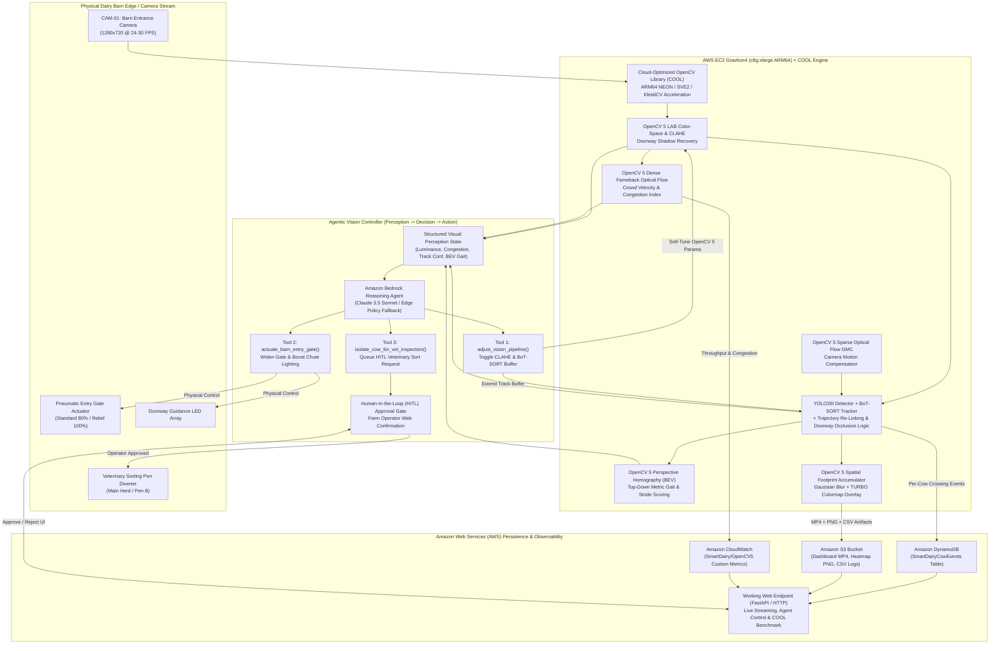
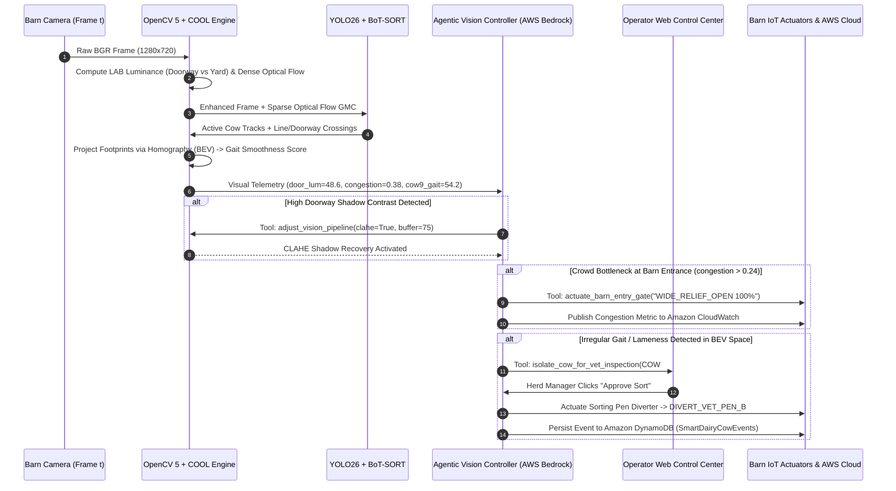

# System Architecture Diagram — Smart Dairy (OpenCV 5 + AWS + Agentic Vision + COOL)

**Competition:** OpenCV AI Competition 2026, powered by AWS  
**Eligible Tracks:** Overall Track • Agentic Vision Award Track • Best Use of COOL Award Track

---

## 1. End-to-End Hybrid Edge-to-Cloud Architecture

---

## 2. Agentic Vision Closed-Loop Sequence Diagram

